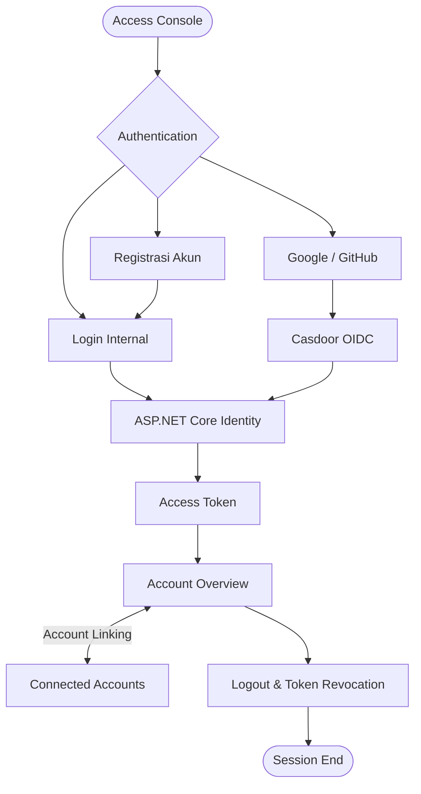
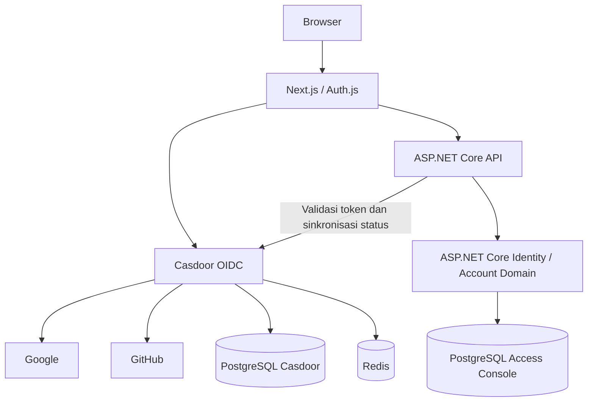

# Access Console

<div align="center">

<a href="https://tenor.com/view/alya-roshidere-anxiety-embarrassed-gif-18434340723034717783">
  
</a>

<p><strong>Identity and Access Management | Fullstack Application</strong></p>

<p>
  
  
  
  
  
  
</p>

[](https://github.com/waifujahat/access-console/actions/workflows/ci.yml)

</div>

Access Console adalah aplikasi fullstack untuk mengimplementasikan **Identity and Access Management** yang menggabungkan autentikasi akun lokal, federasi identitas melalui Casdoor, Social Login Google dan GitHub, Just-in-Time Provisioning, Secure Account Linking, serta otorisasi kepemilikan data. Frontend, backend API dan layanan identitas berjalan sebagai layanan terpisah dengan persistensi PostgreSQL dan penyimpanan sesi Casdoor melalui Redis.

| Fitur | Stack | Link |
| --- | --- | --- |
| Frontend | Next.js 16 | [Coba disini](https://access-console-five.vercel.app/) |
| Registrasi | Next.js | [Buat akun](https://access-console-five.vercel.app/daftar) |
| Backend API | ASP.NET Core 10 | [Health check](https://access-console-api.vercel.app/health) |
| Database readiness | PostgreSQL 17 | [Readiness check](https://access-console-api.vercel.app/health/ready) |
| Identity Provider | Casdoor | [OIDC discovery](https://access-console-casdoor.vercel.app/.well-known/openid-configuration) |
| Source code | GitHub | [Repository](https://github.com/waifujahat/access-console) |

### Flow



## Fitur

### Autentikasi Akun

- Registrasi menggunakan nama, email, dan kata sandi dengan validasi pada frontend, domain dan ASP.NET Core Identity.
- Login lokal menggunakan **ASP.NET Core Identity Bearer Token**, bukan JWT yang diterbitkan secara manual.
- Penyimpanan token akses dalam cookie `HttpOnly`, `Secure` pada production dan `SameSite=Lax` melalui Next.js Server Actions.
- Halaman akun terlindungi pada `/akun`, termasuk pengambilan profil melalui `GET /api/accounts/me`.
- Otorisasi berbasis identitas pemilik pada `GET /api/accounts/{id}`.
- Logout melalui API yang mencatat hash token yang dicabut di PostgreSQL dan menolak penggunaan ulang token tersebut.
- Penyimpanan akun domain dan pengguna Identity dalam satu transaksi database.

### Federasi Identitas dan Pengaitan Akun

- Login Google dan GitHub melalui Auth.js dan Casdoor menggunakan OpenID Connect (OIDC).
- Validasi signature, issuer, audience, masa berlaku dan jenis access token Casdoor pada backend.
- Just-in-Time Provisioning : Pengguna dengan identitas dan email terverifikasi yang baru memperoleh akun Access Console dan UUID unik secara otomatis.
- Identitas eksternal dipetakan berdasarkan pasangan issuer dan subject Casdoor, sehingga login ulang menggunakan identitas yang sama mempertahankan ID akun.
- Secure Account Linking memerlukan sesi lokal yang valid, identitas eksternal yang terverifikasi serta autentikasi terbaru atau konfirmasi kata sandi.
- Identitas eksternal yang terhubung ke akun Access Console lain tidak dapat diambil alih, backend tidak mengaitkan akun lokal secara otomatis berdasarkan email yang sama.
- Connected Accounts pada `/akun` menampilkan status Google dan GitHub berdasarkan profil Casdoor yang terverifikasi, bukan sekadar metode login terakhir.
- Status provider disinkronkan saat login eksternal atau pengaitan akun berhasil dan disimpan sebagai indikator di PostgreSQL, tanpa menyimpan token atau ID provider mentah sebagai data status. Status yang belum tersedia ditampilkan sebagai belum terverifikasi.

### Keamanan

- Hash kata sandi dikelola oleh ASP.NET Core Identity.
- Pencegahan email duplikat menggunakan validasi Identity serta unique index PostgreSQL bertipe `CITEXT`.
- Account lockout setelah 5 kegagalan login selama 15 menit.
- Fixed-window rate limiting untuk registrasi, login per IP dan login per akun terdaftar.
- Header `Cache-Control: no-store` pada endpoint akun dan autentikasi.
- Persistensi Data Protection keys di PostgreSQL dengan perlindungan sertifikat pada lingkungan selain Development.
- Health check untuk proses API dan pemeriksaan kesiapan database.
- Pemeriksaan frontend, backend, migrasi, autentikasi, pengaitan akun, kepemilikan data dan container Casdoor melalui GitHub Actions.

## Teknologi

| Lapisan | Teknologi |
| --- | --- |
| Frontend | Next.js 16, React 19, TypeScript |
| Styling | Tailwind CSS 4 |
| Backend | C#, ASP.NET Core 10 |
| Identity | ASP.NET Core Identity, Identity Bearer Token, Auth.js, Casdoor |
| Protokol federasi | OpenID Connect (OIDC), OAuth 2.0 |
| Database | PostgreSQL 17, Neon untuk deployment |
| Penyimpanan sesi Casdoor | Redis (Upstash), koneksi TLS |
| Persistence | Entity Framework Core 10, Npgsql |
| Infrastruktur | Docker Compose, Vercel Container |
| Pengujian | GitHub Actions, API smoke tests, integration tests OIDC |
| Kualitas kode | ESLint, EditorConfig, `dotnet format` |

## Arsitektur

```text
access-console/
├── .github/workflows/ci.yml           # Verifikasi otomatis
├── backend/AccessConsole.Api/
│   ├── Application/Accounts/          # Kontrak repositori akun
│   ├── Contracts/Accounts/            # Model respons API
│   ├── Domain/                        # Aturan domain akun dan autentikasi
│   ├── Endpoints/                     # Endpoint akun dan autentikasi Casdoor
│   ├── Infrastructure/
│   │   ├── Authentication/            # Pencabutan token akses
│   │   ├── Configuration/             # Pembatasan permintaan
│   │   ├── Identity/                  # Identity, pengaitan dan status provider
│   │   └── Persistence/               # EF Core dan migrasi database
│   └── Program.cs                     # Konfigurasi dan endpoint autentikasi
├── deployment/casdoor/                # Container Casdoor dan startup Redis TLS
├── docs/deployment-casdoor.md         # Konfigurasi deployment identitas
├── public/                            # Aset frontend
├── scripts/                           # Skrip backend dan pengujian autentikasi
├── src/                               # Halaman, Auth.js dan utilitas Next.js
├── compose.yaml                       # PostgreSQL lokal
└── dotnet-tools.json                  # Manifest alat .NET
```

## API

| Metode | Endpoint | Fungsi | Akses |
| --- | --- | --- | --- |
| `GET` | `/health` | Memeriksa proses API | Publik |
| `GET` | `/health/ready` | Memeriksa kesiapan database | Publik |
| `POST` | `/api/auth/register` | Mendaftarkan akun | Publik |
| `POST` | `/api/auth/login` | Login dan memperoleh access token | Publik |
| `POST` | `/api/auth/logout` | Mencabut access token | Bearer token |
| `POST` | `/api/auth/casdoor/verify` | Memverifikasi access token Casdoor | Casdoor access token |
| `POST` | `/api/auth/casdoor/exchange` | Menukar identitas Casdoor menjadi sesi Access Console | Casdoor access token |
| `POST` | `/api/auth/casdoor/link` | Mengaitkan identitas Casdoor ke akun aktif | Bearer token + `X-Casdoor-Token` |
| `GET` | `/api/accounts/me` | Mengambil profil pengguna aktif | Bearer token |
| `GET` | `/api/accounts/{id}` | Mengambil akun milik pengguna | Bearer token |
| `POST` | `/api/accounts` | Endpoint lama mengembalikan `410 Gone` | Publik |

### Registrasi

```http
POST /api/auth/register
Content-Type: application/json
```
```json
{
  "email": "developer@example.com",
  "displayName": "Developer",
  "kataSandi": "Contoh1!"
}
```
### Login

```http
POST /api/auth/login
Content-Type: application/json
```

```json
{
  "email": "developer@example.com",
  "kataSandi": "Contoh1!"
}
```

```http
GET /api/accounts/me
Authorization: Bearer <access-token>
```
```http
POST /api/auth/logout
Authorization: Bearer <access-token>
```
### Status

| Nilai | Keterangan |
| --- | --- |
| `true` | Provider terhubung menurut status terakhir yang terverifikasi |
| `false` | Provider belum terhubung |
| `null` | Status belum terverifikasi atau konfigurasi belum tersedia |

### Kebijakan pembatasan permintaan

| Mekanisme | Batas |
| --- | --- |
| Registrasi per IP | 10 permintaan per menit |
| Login per IP | 120 permintaan per menit |
| Login per akun terdaftar | 10 permintaan per menit |
| Account lockout | 5 kegagalan, selama 15 menit |

### 1. Clone repository
```powershell
git clone https://github.com/waifujahat/access-console.git
cd access-console
```
### 2. PostgreSQL

```dotenv
ACCESS_CONSOLE_DB_PASSWORD=replace-with-a-secure-password
```

```powershell
docker compose --env-file .env.postgres up -d postgres
```
Database lokal tersedia pada `127.0.0.1:5433`

### 3. Migrasi database

```powershell
$Baris = Get-Content .env.postgres |
    Where-Object { $_.StartsWith("ACCESS_CONSOLE_DB_PASSWORD=") } |
    Select-Object -First 1

if (-not $Baris) {
    throw "Password PostgreSQL tidak ditemukan"
}

$Sandi = $Baris.Substring("ACCESS_CONSOLE_DB_PASSWORD=".Length).Trim()

$env:ConnectionStrings__AccessConsole = "Host=127.0.0.1;Port=5433;Database=access_console;Username=access_console;Password=$Sandi"

Remove-Variable Sandi
```
```powershell
dotnet tool restore --tool-manifest dotnet-tools.json

dotnet ef database update `
    --project backend/AccessConsole.Api `
    --startup-project backend/AccessConsole.Api `
    --context AccessConsoleDbContext
```
### 4. Run Backend

```powershell
$env:ASPNETCORE_ENVIRONMENT = "Development"
$env:CASDOOR_ISSUER = "http://127.0.0.1:8000"
$env:CASDOOR_CLIENT_ID = "replace-with-local-client-id"

.\scripts\run-backend.ps1
```

### 5. Run Frontend

Buka terminal baru, buat `.env.local`

```dotenv
ACCESS_CONSOLE_API_URL=http://127.0.0.1:5080
AUTH_URL=http://localhost:3000
AUTH_SECRET=replace-with-random-secret
CASDOOR_ISSUER=http://127.0.0.1:8000
CASDOOR_CLIENT_ID=replace-with-local-client-id
CASDOOR_CLIENT_SECRET=replace-with-local-client-secret
CASDOOR_GOOGLE_PROVIDER=provider_oauth_google
CASDOOR_GITHUB_PROVIDER=provider_oauth_github
```

```powershell
npm.cmd ci
npm.cmd run dev
```

## Deployment

```powershell
npm.cmd run lint
npm.cmd run build
dotnet format backend/AccessConsole.Api/AccessConsole.Api.csproj --verify-no-changes
dotnet build backend/AccessConsole.Api/AccessConsole.Api.csproj --configuration Release
```

## Catatan

| Variabel | Kegunaan |
| --- | --- |
| `ConnectionStrings__AccessConsole` | Koneksi PostgreSQL untuk backend |
| `ACCESS_CONSOLE_API_URL` | Alamat API untuk request server-side Next.js |
| `AUTH_URL` | URL kanonis frontend untuk autentikasi Auth.js |
| `AUTH_SECRET` | Rahasia autentikasi Auth.js yang tetap antar deployment |
| `CASDOOR_ISSUER` | Issuer OIDC Casdoor untuk frontend dan backend |
| `CASDOOR_CLIENT_ID` | Client ID aplikasi Casdoor untuk frontend dan backend |
| `CASDOOR_CLIENT_SECRET` | Client secret Casdoor, hanya frontend |
| `CASDOOR_GOOGLE_PROVIDER` | Nama provider Google pada aplikasi Casdoor |
| `CASDOOR_GITHUB_PROVIDER` | Nama provider GitHub pada aplikasi Casdoor |
| `ReverseProxy__TrustedProxy` | Alamat IP reverse proxy yang diizinkan mengirim forwarded headers |
| `DataProtection__CertificateBase64` | Sertifikat untuk melindungi Data Protection keys di luar Development |
| `DataProtection__CertificatePassword` | Kata sandi sertifikat Data Protection |

## Dokumentasi Repository

- [Lisensi Proprietary](LICENSE)
- [Panduan kontribusi](CONTRIBUTING.md)
- [Kebijakan keamanan dan pelaporan kerentanan](SECURITY.md)
- [Panduan deployment Casdoor dan OAuth](docs/deployment-casdoor.md)

---

<p align="center">
  <sub>
    Developed by <a href="https://github.com/waifujahat">waifujahat</a>
  </sub>
</p>
